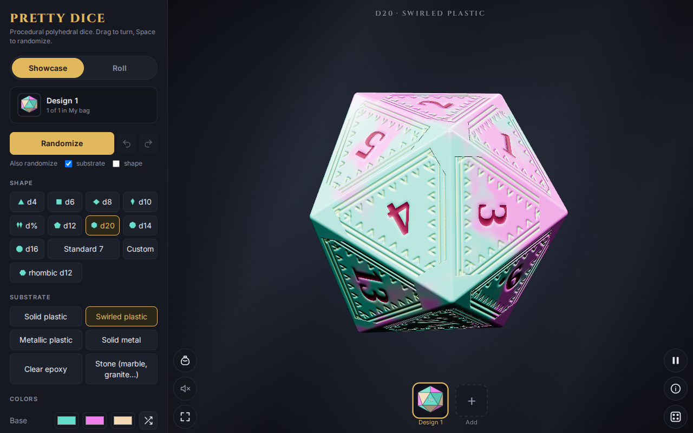

# First steps

When the page opens you see one die turning slowly in the middle of the screen (the **showcase**), the settings panel on the left, and your design shelf along the bottom.

## The two modes

The toggle at the top of the panel switches between:

- **Showcase**: the die floats and turns. Drag to turn it by hand, scroll or pinch to zoom, right-drag or use two fingers to orbit, double-click to reset the view. This is where you design.
- **Roll**: the dice are thrown onto a table and settle, and the total appears. This is where you play. Roll mode shows the **Roll feel & sound** settings instead of the showcase ones.

The round **Roll the dice** button at the bottom right is a shortcut: tap it to throw, tap again to go back to the showcase.

## Try these first

1. Press **Randomize** (or Space). A new look appears. The arrows beside it undo and redo (Ctrl+Z, Ctrl+Y). "Also randomize" lets you include the substrate or the shape.
2. Pick a **Shape** (d4 to d20, d%, rhombic d12 and others) and a **Substrate** (plastic, metal, epoxy, stone).
3. Switch to **Roll**. Press `r` to roll again.

## The buttons on the table

| Button | What it does |
|---|---|
| Layout (top of the left column) | Hides or shows the settings panel for a full view. Long-press for the distraction-free view. |
| Speaker | Sound on or off. |
| Pause | Stops the showcase spin. |
| Hints (i) | Lists the gestures and shortcuts. |
| Roll log | Opens the list of past rolls. See [the roll log](06-roll-log.md). |
| Bag | Opens all your designs. See [the bag and shelf](03-bag-and-shelf.md). |

## Where next

Design something: [Designing a die](02-designing-a-die.md).
