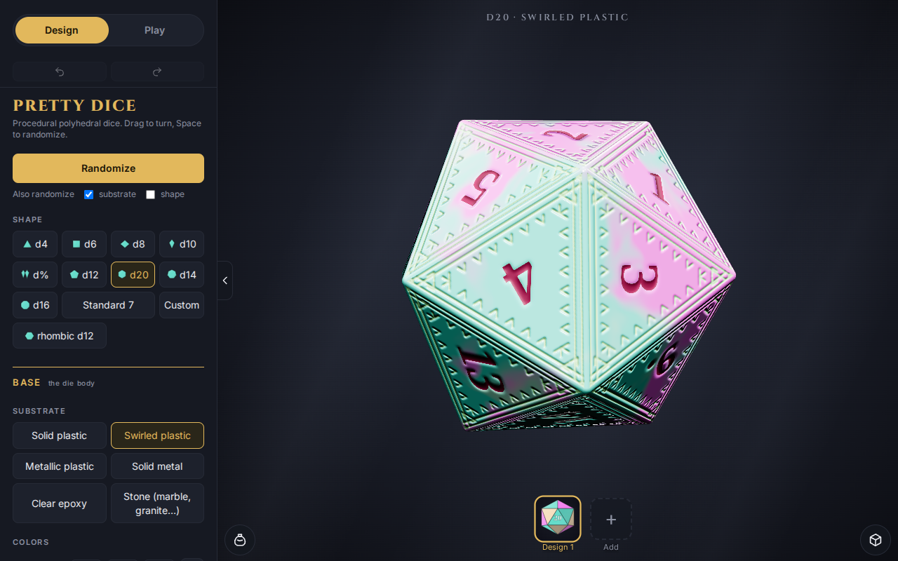

# First steps

When the page opens you see one die turning slowly in the middle of the screen, the side panel on the left, and your design shelf along the bottom. On a phone the panel sits below the table.

## Two rooms: Design and Play

One switch, **Design | Play**, decides what you are doing (at the top of the side panel on a desktop; on a phone it lives in the Utilities drawer, as **Switch to Play** / **Switch to Design**). Switching never throws the dice.

- **Design room**: the die floats and turns. Drag to turn it by hand, scroll or pinch to zoom, right-drag or two fingers to orbit, double-click to reset the view. The panel is always the **Look** settings (shape, material, colours, numbers, Randomize, save and export), with **Undo** and **Redo** in a strip at its top. The round **Bag** button at the bottom left of the table opens the Bag view (your designs and saved sets), and the shelf sits along the bottom of the table.
- **Play room**: the dice lie on the table. The panel has the tabs **Table** (dice to roll, roll feel and sound), **Games** and **Log**. A dock along the bottom of the table has the formula box, the one gold **Roll** button (the only button that throws dice) and the preset chips.

## Try these first

1. In the Design room, press **Randomize** (or Space). A new look appears. **Undo** and **Redo** at the top of the panel step back and forward (Ctrl+Z, Ctrl+Y). "Also randomize" lets you include the substrate or the shape.
2. Pick a **Shape** (d4 to d20, d%, rhombic d12 and others) and a **Substrate** (plastic, metal, epoxy, stone).
3. Switch to **Play** and press **Roll** (or `r`). Press it again to throw again.

## The controls that are always there

| Control | What it does |
|---|---|
| **Design | Play** switch | Changes room. Never throws. Top of the side panel on a desktop; in the Utilities drawer on a phone. |
| Utilities (the paired-circles button, bottom right of the table) | Opens the drawer: **Design | Play** (in every view), sound on or off, **Reset view**, **Full view**, **Hints**, and **Pause spin** in the Design room. |
| Panel handle | The small arrow at the edge of the panel (on a phone, at the middle of the tab row) hides it for a full view of the table; the same arrow at the screen edge brings it back. `h` does the same. |
| Dock (Play room) | Formula box, preset chips (d4 to d%, Adv, Dis) and the **Roll** button. See [Rolling](05-rolling.md). |
| Shelf (Design room) | Your designs; tap one to switch to it. See [the bag and shelf](03-bag-and-shelf.md). |

## If it loads slowly

The first load builds the dice and can take a while on a slow device. A boot screen with a tumbling die shows the step name, "step N of M" and the elapsed time. If the page freezes for a moment later, a small toast near the top, **UI paused N s**, says so; tap it to copy the details if you need to report a problem.

## Where next

Design something: [Designing a die](02-designing-a-die.md).
