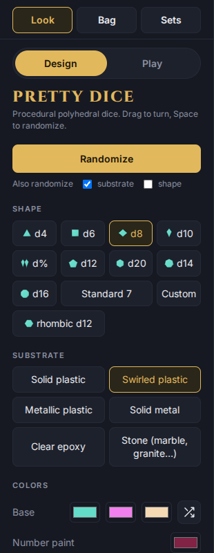
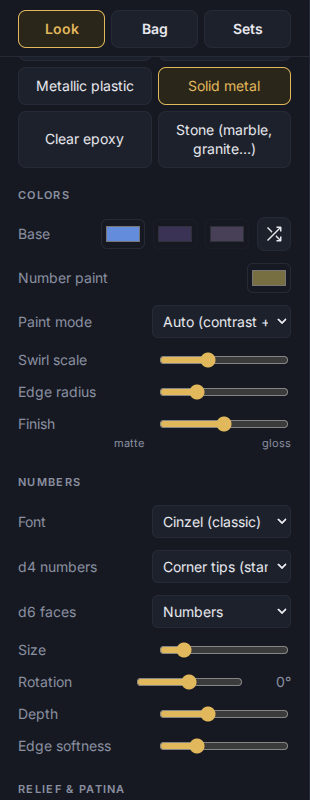
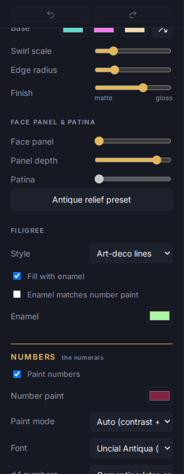
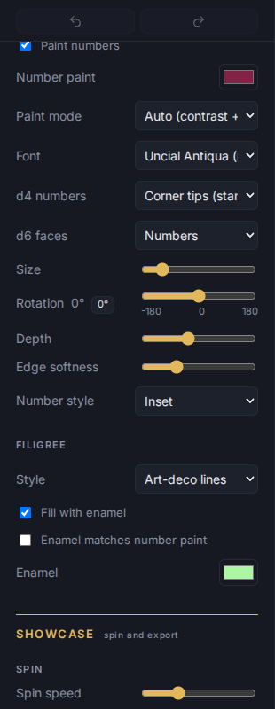
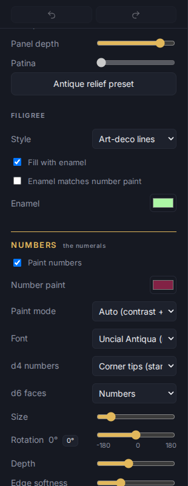

# Designing a die

Everything here is in the **Look** tab of the side panel in the Design room. Changes show immediately and can be undone with Ctrl+Z. Each design in the bag remembers its own look. The controls below the shape are sorted into two sections: **Base** (the die body: substrate, colours, stone, epoxy, face panel and patina, filigree) and **Numbers** (the numerals: paint, font, size, relief style).

## Shape

d4, d6, d8, d10, d%, d12, d20, d14 and d16, plus a rhombic d12. **Standard 7** and **Custom** roll several dice at once; Custom lets you build your own mix: see [Sets and the editor](04-sets-and-editor.md).

## Substrate (Base)

The material the die is made of (choosing **Stone** gives you a random stone; the **Type** list that appears in the Stone section, further down the panel, picks marble, granite, malachite, lapis lazuli, agate, onyx, jasper, obsidian, turquoise, amethyst, tiger's eye or opal, and there is an **Accent** colour too): **Solid plastic**, **Swirled plastic**, **Metallic plastic**, **Solid metal**, **Clear epoxy** and **Stone** (marble, granite and so on). Choosing one changes which of the controls below apply.

## Colours (Base)

- **Base** holds up to three colour swatches. The dice button beside them picks a new set.
- **Swirl scale** and **Edge radius** shape the pattern and how rounded the corners are.
- **Finish**: from matte to gloss.

## Numbers (the Numbers section)

- **Paint numbers**, **Number paint** and **Paint mode** come first: whether the digits are painted, their colour, and how it is chosen (Auto: contrast plus harmony, Random, or Custom).
- **Font**: Cinzel (classic), Metamorphous (fantasy), Uncial Antiqua (runic), Inter (clean sans), Georgia (serif) or Courier (mono).
- **d4 numbers**: on the corner tips (the standard way) or in the face centre.
- **d6 faces**: numbers or pips.
- **Size**, **Rotation**, **Depth** and **Edge softness** adjust the digits.
- **Number style** (the last Numbers control): **Inset** or **Raised (embossed)**. Raised needs a face panel (see below).

## Face panel, patina and filigree (Base)

- **Face panel** and **Panel depth** sink or raise a panel behind the number. The panel is what lets the numbers be Raised.
- **Patina** ages the die; **Antique relief preset** applies a worn look in one click.
- **Filigree** adds ornament: Scrollwork, Beaded border or Art-deco lines. **Fill with enamel** colours it in; **Enamel matches number paint** keeps the two in step.

## Naming and keeping a design

Give it a name under **Save & export** (the Name box) before saving it to a file. See [Saving and loading](07-save-load.md).
