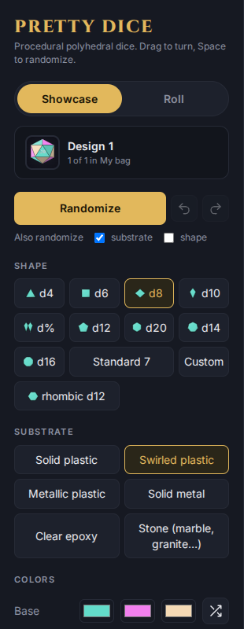
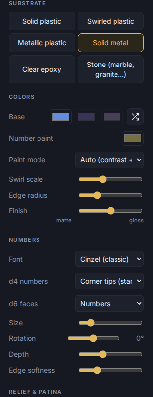
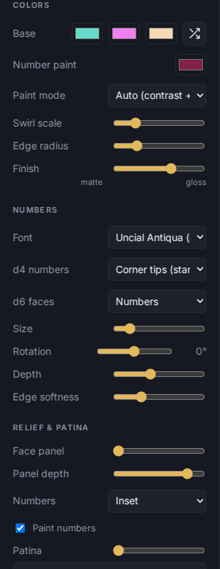
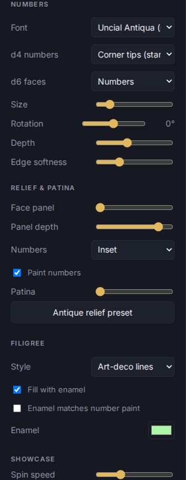
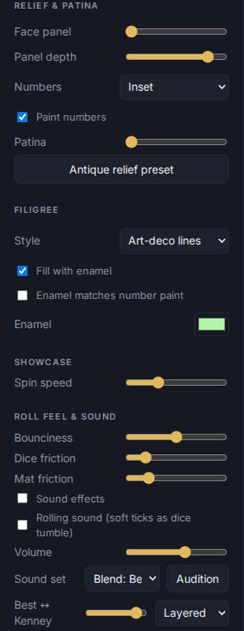

# Designing a die

Everything here is in the settings panel in **Showcase** mode. Changes show immediately and can be undone with Ctrl+Z. Each design in the bag remembers its own look.

## Shape

d4, d6, d8, d10, d%, d12, d20, d14 and d16, plus a rhombic d12. **Standard 7** and **Custom** roll several dice at once; Custom lets you build your own mix: see [Sets and the editor](04-sets-and-editor.md).

## Substrate

The material the die is made of: **Solid plastic**, **Swirled plastic**, **Metallic plastic**, **Solid metal**, **Clear epoxy** and **Stone** (marble, granite and so on). Choosing one changes which of the controls below apply.

## Colours

- **Base** holds up to three colour swatches. The dice button beside them picks a new set.
- **Number paint** is the colour of the digits.
- **Paint mode**: Auto (contrast plus harmony), Random, or Custom.
- **Swirl scale** and **Edge radius** shape the pattern and how rounded the corners are.
- **Finish**: from matte to gloss.

## Numbers

- **Font**: Cinzel (classic), Metamorphous (fantasy), Uncial Antiqua (runic), Inter (clean sans), Georgia (serif) or Courier (mono).
- **d4 numbers**: on the corner tips (the standard way) or in the face centre.
- **d6 faces**: numbers or pips.
- **Size**, **Rotation**, **Depth** and **Edge softness** adjust the digits.

## Relief and patina, filigree

- **Face panel** and **Panel depth** sink or raise a panel behind the number. **Numbers** can be **Inset** or **Raised (embossed)**, and **Paint numbers** fills them.
- **Patina** ages the die; **Antique relief preset** applies a worn look in one click.
- **Filigree** adds ornament: Scrollwork, Beaded border or Art-deco lines. **Fill with enamel** colours it in; **Enamel matches number paint** keeps the two in step.

## Naming and keeping a design

Give it a name under **Save & export** (the Name box) before saving it to a file. See [Saving and loading](07-save-load.md).
