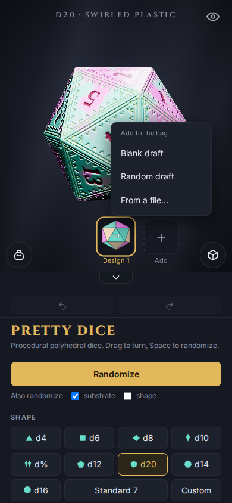
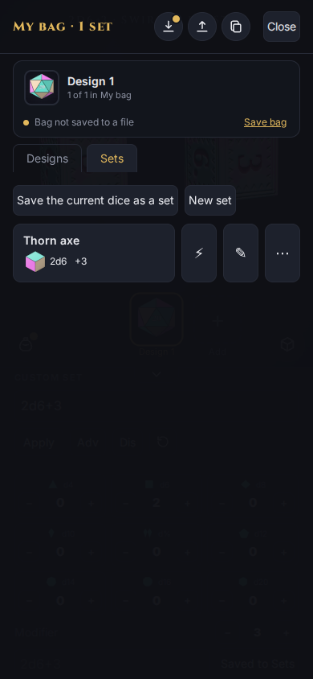

# The bag and shelf

Your **bag** holds all your designs. The **shelf** along the bottom of the table (in the Design room) shows them as small pictures; tap one to switch to it. The panel header says which one you are on ("Design 1, 1 of 1 in My bag").

## Adding a design

Tap **+ Add** at the end of the shelf. You can choose:

- **Blank draft**: a new design from scratch
- **Random draft**: a fresh random look. In the Look tab a block under Randomize shows its thumbnail and name with **Keep** and **Discard**. When you change a design that is already in the bag, the same block shows **Save**, **Save as copy** and **Revert** (the same actions as in the Bag view)
- **From a file…**: add a design saved earlier

On a phone the shelf sits at the bottom of the table, with **+ Add** at its end.

## The Bag view

Press the round **Bag** button at the bottom left of the table (in either room, on a phone or a desktop). It opens the Bag view, a sheet with two tabs, **Designs** and **Sets**; **Close** or Esc returns to the table. **Designs** lists every design as a card; the **⋯** menu on a card has the per-design actions. This is the one place to save the bag, load a bag or copy the bag as JSON (three icons at the top).

Changes to a design are held until you save them. The bag shows when the current design is modified and offers **Save**, **Save as copy** and **Revert**.

### Sets in the bag

The **Sets** tab of the Bag view has two buttons at the top: **Save the current dice as a set** (opens the editor on a draft filled with the dice on the table) and **New set** (opens an empty draft). Nothing joins the bag until you press **Save** in the editor. Below them it lists saved sets (name and dice, for example "Thorn axe: 2d6 +3"). Each set card has:

- **⚡** quick roll: rolls that set straight away and records it in the log.
- **✎** edit: opens the set's editor in the tab (presets, formula, modifier and an optional result table).
- **⋯** menu: Edit, Make a copy, Open (loads the set and goes to the Play room without throwing), Move up, Move down, Delete.

See [Sets and the editor](04-sets-and-editor.md) for building and saving sets.
