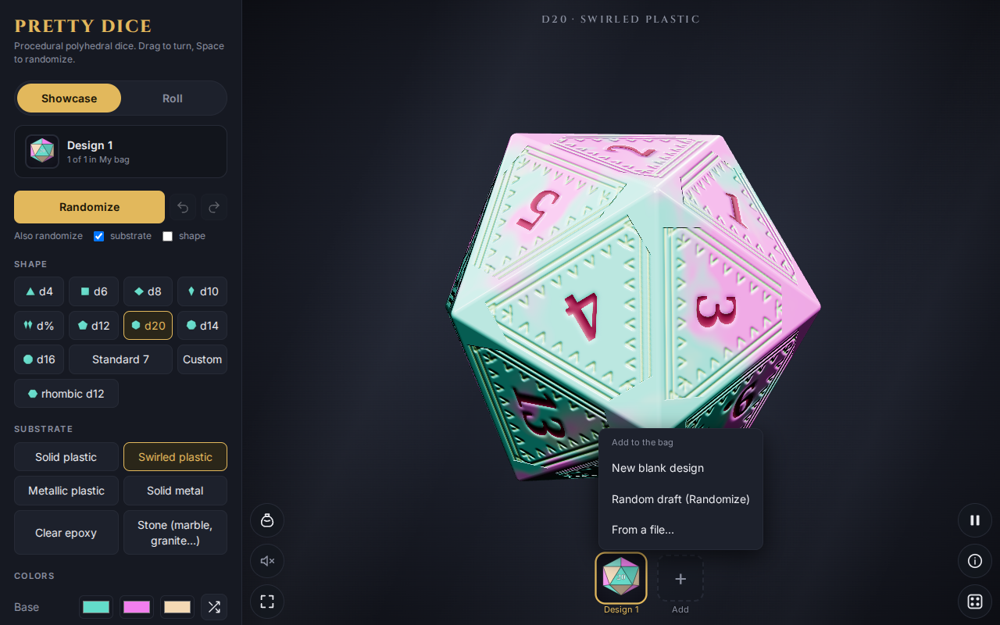
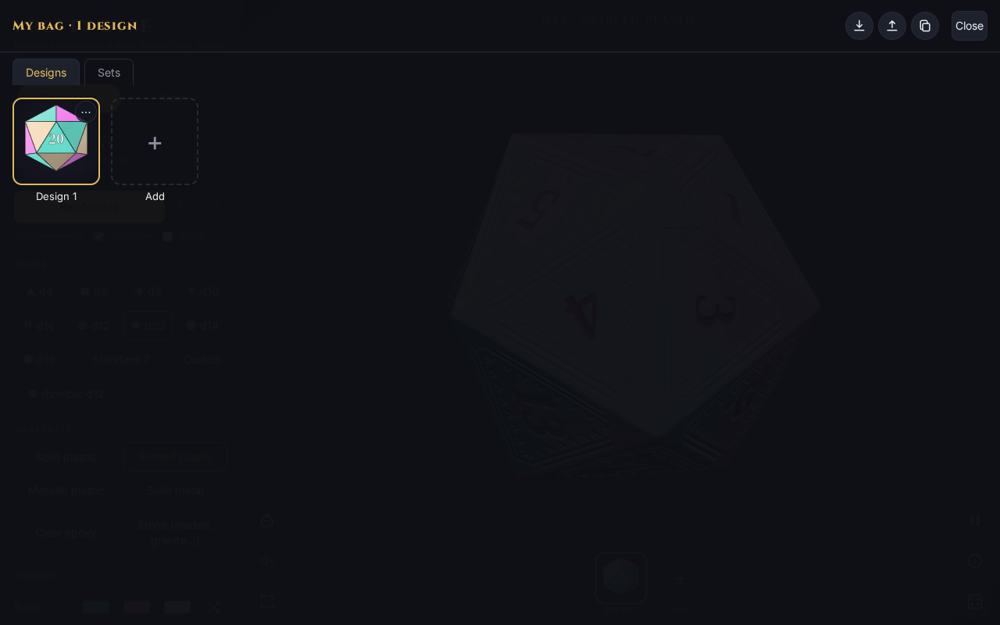

# The bag and shelf

Your **bag** holds all your designs. The **shelf** along the bottom of the screen shows them as small pictures; tap one to switch to it. The panel header says which one you are on ("Design 1, 1 of 1 in My bag").

## Adding a design

Tap **Add** at the end of the shelf. You can choose:

- **New blank design**
- **Random draft (Randomize)**: a fresh random look
- **From a file…**: add a design saved earlier

## The bag sheet

The bag button (bottom left) opens a full-screen sheet. **Designs** lists every design as a card; the **⋯** menu on a card has the per-design actions. The three icons at top right save the bag, load a bag and copy the bag as JSON. **Close** returns to the table.

Changes to a design are held until you save them. The bag shows when the current design is modified and offers **Save**, **Save as copy** and **Revert**.

See [Sets and the editor](04-sets-and-editor.md) for the **Sets** tab.
