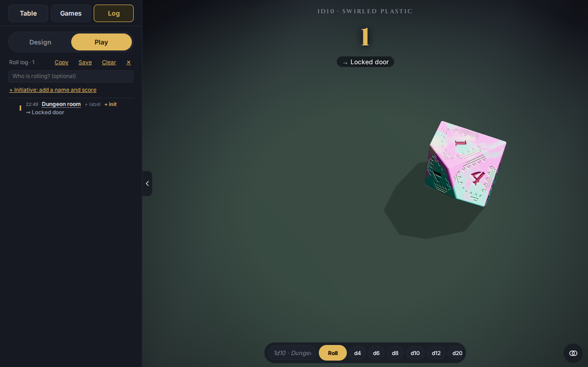

# Sets and the editor

A **set** is a group of dice you roll together, for example 2d6 + 3 for an axe. You build one with the **Custom** shape, then **save it as a set** so you can roll it again with one tap.

## Build a set


Choose **Custom** under Shape. The **Custom set** section has:

- A **notation** box: type a roll and press **Apply** (or Enter). Errors show in red under the box. The small button beside it resets to a single d20.
- **Shape buttons** (Design Look tab and Play Table tab work the same way, and never roll): a tap picks one die of that shape and collapses Custom set; a double-click or long press adds one die to the formula and opens Custom set so the whole formula shows.
- **Adv** and **Dis** buttons: a click replaces the formula with advantage (`d20adv`, 2d20 keep the highest) or disadvantage (`d20dis`); a double-click or long press adds it to the formula instead.
- **+ and −** for each die type, and a **Modifier**.
- **Dice use**, when your bag has several designs: which design the + button adds to the formula. (This is about the dice in the set. For the look the set brings when you pick it, see **Look** under [Sets and designs](#sets-and-designs).)

### What the notation accepts

Dice are written `<count>d<sides>`; the count may be left off. Letters can be upper or lower case, and spaces are ignored. Sides can be 4, 6, 8, 10, %, 12, 14, 16 or 20 (`d%` and `d100` both mean the percentile die). You can add more than one kind of die and a plus or minus number. At most 24 dice.

| You type | The box rewrites it as | Meaning |
|---|---|---|
| `d20+5` | `1d20+5` | one d20 plus 5 |
| `8d6` | `8d6` | eight d6 |
| `d%+d10+2` | `1d%+1d10+2` | percentile die plus a d10, plus 2 |
| `4d6kh3` | `4d6kh3` | roll 4, **k**eep the **h**ighest 3 |
| `2d20kl1` | `2d20kl1` | roll 2, **k**eep the **l**owest 1 |
| `4d6dl1` | `4d6kh3` | roll 4, **d**rop the **l**owest 1 (same as keep highest 3) |
| `4d6dh1` | `4d6kl3` | roll 4, **d**rop the **h**ighest 1 |
| `d20 adv` | `2d20kh1` | advantage; `dis` gives `2d20kl1` |
| `d20 adv+5` | `2d20kh1+5` | advantage with a modifier: put `adv` or `dis` right after the die, then the modifier. `d20+5 adv` is not understood |
| `4d6kh` | `4d6kh1` | a keep with no number keeps one |
| `d20r1+5` | `1d20r1+5` | **r**eroll: a die that lands showing 1 is thrown again, once, and the new value stands (the halfling "reroll a 1") |
| `4d6r<=2` | `4d6r<=2` | reroll each die that shows 2 or less; also `r<3`, `r>5`, `r>=5` (`r1` means exactly 1) |
| `d20 adv r1` | `2d20r1kh1` | rerolls come first, then keep or drop; `r` may be written before or after `kh`/`kl`/`adv` |
| `4x d20r1+2` | `4x 1d20r1+2` | works in a group: every die in every roll |

When dice are dropped (by keep, drop, `adv` or `dis`) the table marks them with a grey ring, they do not count, and the breakdown shows them in parentheses: `5+6+5+(3) = 16`.

### Several rolls at once: group roll

Put a count and `x` in front to make separate rolls: `4x d20+2` throws four d20s, adds the +2 to **each**, and shows the results side by side (for example `22 · 7 · 16 · 17`) with a breakdown per roll (`#1: 20 + 2 = 22`). Use it for a pack of goblins attacking or everyone rolling initiative. It works in the notation box here and in the dock at the table ([Rolling](05-rolling.md)). Each group member can be added to the initiative list: see [The roll log](06-roll-log.md).

### Picture faces

A die can carry small pictures instead of numbers. Add a **face block** in curly braces right after the die (and after any keep or `adv`), before an optional `@design`:

`NdS{pack#seed}`, with the optional flags `!same` and `!ordered`, then `@design`.

| You type | Meaning |
|---|---|
| `5d12{noto#1}` | five d12, every face a different picture from the Everyday pictures pack, dealt with seed 1 |
| `3d6{memes&noto#2}@bone` | three d6 dealt from the Memes and Everyday packs together with seed 2, using the bag's design called `bone` (the `@design` must exist in your bag, or the box says `No design "@bone" in the bag`) |
| `4d8{gameicons#7!same}` | every die carries the same eight pictures |
| `2d6{hiero!ordered}` | the pack's pictures in their own order, no seed (an ordered deal takes none) |

The pack names are `noto` (Everyday pictures), `symbols`, `memes`, `gameicons` (Fantasy and adventure), `fontawesome` (Plain icons) and `hiero` (Hieroglyphs); join several with `&`. The seed is a number from 1 to 999999 (left off it means 1). The same text deals the same pictures on every device, and adding a die at the end keeps the faces of the dice before it. Glyph faces work on d6, d8, d12 and d20 only. Unless you ask for `!same`, no picture repeats, so the packs must hold enough: five d12 need 60 pictures, and the box says so ("Set needs 60 faces; ... holds ...") if not. A face counts in totals by its position on the die (1 to the number of sides), so keep highest, `adv` and the rest work on glyph dice too. The [Story Dice sets editor](10-games.md#story-dice-sets) builds this text for you.

A rerolled die shows its first value in the breakdown, the roll log and Copy: `1→14 + 5 = 19`. The final value counts for the total and for Natural 20 / Natural 1; the die on the table shows the final face.

The reroll is a real throw. When the dice have settled, each die whose face matches the rule gets a green ring for half a second, then only those dice are thrown again, the way leaning dice are; the total appears once they have settled. A die is thrown once: if its second face matches too, it stays. With **Manual rerolls** switched on (Table tab, physics settings), the ring stays and a green **Re-roll** chip appears in the upper right, under any leaning chip; tap it to throw those dice. Starting a new roll instead drops the reroll, and the first faces stand and are logged. A quick roll from the box or a set button has no dice on the table, so it simply draws the new value. Rerolls are not extra dice, so they do not count toward the 24-dice limit. A condition that matches every face (`d6r<7`) or none, or `r` with no number, is refused with a message; `r` does not work on `d%` or on dice with custom faces.

Not understood yet: exploding dice (`d20!`), and the words "advantage" and "disadvantage" spelled out (use `adv` or `dis`, or the buttons). A bad entry shows a message such as `d7 not supported (use d4 d6 d8 d10 d%/d100 d12 d14 d16 d20)` or `Too many dice (101); max 24`.

## Save it as a set

Type a name in the **Set name** box (under the Modifier row; empty, it shows the name a blank box would get) and press **Save as set** or Enter. This is a different box from the design **Name** in Save & export: that one names a design file. The **Sets** tab of the Bag view has two more ways, and both open the set editor on a **draft**: **Save the current dice as a set** pre-fills the draft with the dice on the table, and **New set** starts from an empty draft where you pick the dice yourself. A draft is not in the bag yet. Name it, set the dice, modifier and any result table, then press **Save** (or **Save this set**); the app confirms with "Saved <name> to the bag". Saving a draft with no dice says "Add at least one die first". Press ✕ (or Discard) to throw the draft away; if you changed it, you are asked to confirm. Saved sets live in the Bag view's **Sets** tab and also appear as chips in the dock at the table. Open the Bag view (the round Bag button) and its **Sets** tab, and use ⚡ to roll one, ✎ to edit it or ⋯ for Edit, Make a copy, Open, Move up/down and Delete. In the Play room, the Table tab lists saved sets too: tap one to load it, then press **Roll**. See [The bag and shelf](03-bag-and-shelf.md).

## Sets and designs

A design is a **look**: the colours, material, numbers and so on. A set is **dice**: which shapes, how many, plus a modifier. The two are kept apart, so **picking a design never changes your dice**; it only restyles them. A design does remember the dice it was saved with and offers them as a **Suggested** chip (for example `Suggested: d20` or `Suggested: 3d6+2`) next to the Shape heading in the Design room's Look tab. Tap it to use those dice; ignore it and your dice stay as they are. The chip is not shown when the dice already match, or while a game's dice are on the table.

A set can also carry a look. Open a set (✎ in the Bag's **Sets** tab) and, when the bag has two or more designs, a **Use design for this set:** row at the top, right under the name, lists **Follow selection** and your designs. **Follow selection** is the default and means the set leaves the look alone (the table keeps whatever design you have selected). Choose a design and picking the set (from the Bag, the Table tab or a quick-roll chip) restyles your dice with that design;. Dice in the set that name their own design with `@name` keep that design. The set list shows the linked design's small picture before the set's name. You can restyle afterwards by picking another design; rolling again with the formula box does not re-apply the set's look. Deleting a design removes the link from any set that used it. Story Dice sets do not have this row, because their `@design` already does that.

## Give a set a result table

A set can carry a table of outcomes, for a random encounter or a loot roll. Press the Bag button, go to **Sets**, tap ✎ on the set, and fill in the **Result table** box at the bottom with one line per result:

```
1-2 Locked door
3 Empty room
4-8 Goblins
9+ Boss
```

Press **Save**. Each line starts with a number, a range (`4-8`) or an open range (`9+`) followed by the text. Numbers only. A `d%` set covers 1 to 100.



When that set rolls, the matching line (for example **→ Locked door**) appears under the total, in the roll log entry, and in the text you copy or save from the log.
