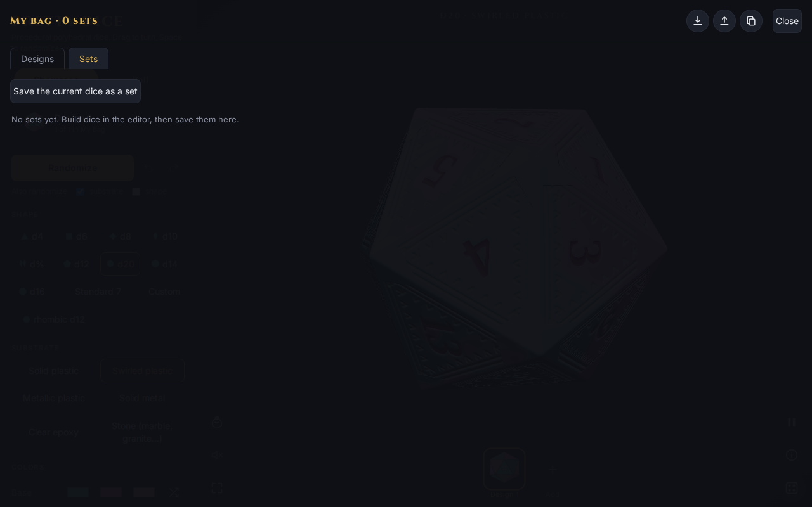

# Sets and the editor

A **set** is a group of dice you roll together, for example 2d6 + d20 + 3. The **Custom** shape is where you build one.

## Building a set

Choose **Custom** under Shape. The **Custom set** section opens with:

- A **notation** box: type something like `4d6+2d10+3` and press **Set** (or Enter). Errors show in red under the box. The small button beside it resets to a single d20.
- **+ and −** buttons for each die type (d4 to d20, d%), so you can build without typing.
- **Dice use**: when your bag has more than one design, a menu choosing which design the + button adds.
- **Modifier**: a number added to the total.
- A name box and **Save**, which stores these dice as a named set in the bag. The notation is written in its long form, so `2d6+d20+3` becomes `2d6+1d20+3`.

## Saved sets

Open the bag and choose the **Sets** tab. Until you save one it says "No sets yet. Build dice in the editor, then save them here." Saved sets can be opened to roll straight away.
