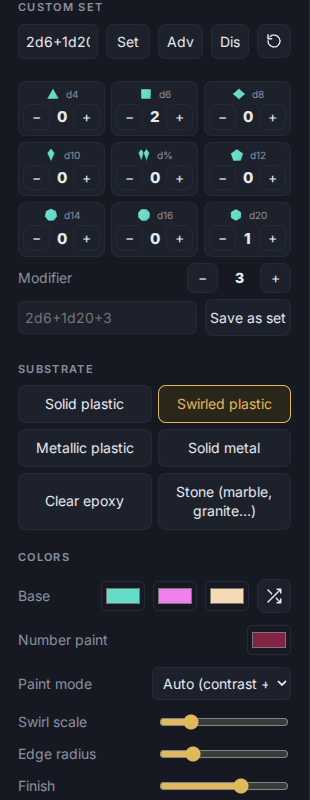

# Sets and the editor

A **set** is a group of dice you roll together, for example 2d6 + 3 for an axe. You build one with the **Custom** shape, then **save it as a set** so you can roll it again with one tap.

## Build a set

Choose **Custom** under Shape (in Showcase). The **Custom set** section has:

- A **notation** box: type a roll and press **Set** (or Enter). Errors show in red under the box. The small button beside it resets to a single d20.
- **Adv** and **Dis** buttons: apply advantage (2d20, keep the highest) or disadvantage (2d20, keep the lowest) to the d20.
- **+ and −** for each die type, and a **Modifier**.
- **Dice use**, when your bag has several designs: which design the + button adds.

### What the notation accepts

Dice are written `<count>d<sides>`; the count may be left off. Letters can be upper or lower case, and spaces are ignored. Sides can be 4, 6, 8, 10, %, 12, 14, 16 or 20 (`d%` and `d100` both mean the percentile die). You can add more than one kind of die and a plus or minus number. At most 24 dice.

| You type | The box rewrites it as | Meaning |
|---|---|---|
| `d20+5` | `1d20+5` | one d20 plus 5 |
| `8d6` | `8d6` | eight d6 |
| `d%+d10+2` | `1d%+1d10+2` | percentile die plus a d10, plus 2 |
| `4d6kh3` | `4d6kh3` | roll 4, **k**eep the **h**ighest 3 |
| `2d20kl1` | `2d20kl1` | roll 2, **k**eep the **l**owest 1 |
| `4d6dl1` | `4d6kh3` | roll 4, **d**rop the **l**owest 1 (same as keep highest 3) |
| `4d6dh1` | `4d6kl3` | roll 4, **d**rop the **h**ighest 1 |
| `d20 adv` | `2d20kh1` | advantage; `dis` gives `2d20kl1` |
| `4d6kh` | `4d6kh1` | a keep with no number keeps one |

Not understood yet: rerolls (`4d6r1`), exploding dice (`d20!`), `x` repeats, and the words "advantage" and "disadvantage" spelled out (use `adv` or `dis`, or the buttons). A bad entry shows a message such as `d7 not supported (use d4 d6 d8 d10 d%/d100 d12 d14 d16 d20)` or `Too many dice (101); max 24`.

## Save it as a set

Type a name in **Name this set** (under the Modifier row) and press **Save as set**. This is a different box from the design **Name** in Save & export: that one names a design file. Saved sets live in the bag's **Sets** tab; open the bag, choose **Sets**, and use ⚡ to roll one or ✎ to edit it. See [The bag and shelf](03-bag-and-shelf.md).
