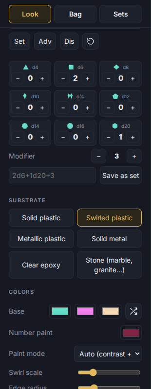

# Sets and the editor

A **set** is a group of dice you roll together, for example 2d6 + 3 for an axe. You build one with the **Custom** shape, then **save it as a set** so you can roll it again with one tap.

## Build a set



Choose **Custom** under Shape. The **Custom set** section has:

- A **notation** box: type a roll and press **Set** (or Enter). Errors show in red under the box. The small button beside it resets to a single d20.
- **Adv** and **Dis** buttons: apply advantage (2d20, keep the highest) or disadvantage (2d20, keep the lowest) to the d20.
- **+ and −** for each die type, and a **Modifier**.
- **Dice use**, when your bag has several designs: which design the + button adds.

### What the notation accepts

Dice are written `<count>d<sides>`; the count may be left off. Letters can be upper or lower case, and spaces are ignored. Sides can be 4, 6, 8, 10, %, 12, 14, 16 or 20 (`d%` and `d100` both mean the percentile die). You can add more than one kind of die and a plus or minus number. At most 24 dice.

| You type | The box rewrites it as | Meaning |
|---|---|---|
| `d20+5` | `1d20+5` | one d20 plus 5 |
| `8d6` | `8d6` | eight d6 |
| `d%+d10+2` | `1d%+1d10+2` | percentile die plus a d10, plus 2 |
| `4d6kh3` | `4d6kh3` | roll 4, **k**eep the **h**ighest 3 |
| `2d20kl1` | `2d20kl1` | roll 2, **k**eep the **l**owest 1 |
| `4d6dl1` | `4d6kh3` | roll 4, **d**rop the **l**owest 1 (same as keep highest 3) |
| `4d6dh1` | `4d6kl3` | roll 4, **d**rop the **h**ighest 1 |
| `d20 adv` | `2d20kh1` | advantage; `dis` gives `2d20kl1` |
| `d20 adv+5` | `2d20kh1+5` | advantage with a modifier: put `adv` or `dis` right after the die, then the modifier. `d20+5 adv` is not understood |
| `4d6kh` | `4d6kh1` | a keep with no number keeps one |

When dice are dropped (by keep, drop, `adv` or `dis`) the table marks them with a grey ring, they do not count, and the breakdown shows them in parentheses: `5+6+5+(3) = 16`.

### Several rolls at once: group roll

Put a count and `x` in front to make separate rolls: `4x d20+2` throws four d20s, adds the +2 to **each**, and shows the results side by side (for example `22 · 7 · 16 · 17`) with a breakdown per roll (`#1: 20 + 2 = 22`). Use it for a pack of goblins attacking or everyone rolling initiative. It works in the notation box here and in the dock at the table ([Rolling](05-rolling.md)). Each group member can be added to the initiative list: see [The roll log](06-roll-log.md).

Not understood yet: rerolls (`4d6r1`), exploding dice (`d20!`), and the words "advantage" and "disadvantage" spelled out (use `adv` or `dis`, or the buttons). A bad entry shows a message such as `d7 not supported (use d4 d6 d8 d10 d%/d100 d12 d14 d16 d20)` or `Too many dice (101); max 24`.

## Save it as a set

Type a name in the **Set name** box (under the Modifier row; empty, it shows the name a blank box would get) and press **Save as set** or Enter. This is a different box from the design **Name** in Save & export: that one names a design file. The **Sets** tab has two more ways, and both open the set editor on a **draft**: **Save the current dice as a set** pre-fills the draft with the dice on the table, and **New set** starts from an empty draft where you pick the dice yourself. A draft is not in the bag yet. Name it, set the dice, modifier and any result table, then press **Save** (or **Save this set**); the app confirms with "Saved <name> to the bag". Saving a draft with no dice says "Add at least one die first". Press ✕ (or Discard) to throw the draft away; if you changed it, you are asked to confirm. Saved sets live in the **Sets** tab and also appear as chips in the dock at the table. Open the **Sets** tab, and use ⚡ to roll one, ✎ to edit it or ⋯ for Edit, Make a copy, Open, Move up/down and Delete. In the Play room, the Table tab lists saved sets too: tap one to load it, then press **Roll**. See [The bag and shelf](03-bag-and-shelf.md).

## Give a set a result table

A set can carry a table of outcomes, for a random encounter or a loot roll. Open the bag, go to **Sets**, tap ✎ on the set, and fill in the **Result table** box at the bottom with one line per result:

```
1-2 Locked door
3 Empty room
4-8 Goblins
9+ Boss
```

Press **Save**. Each line starts with a number, a range (`4-8`) or an open range (`9+`) followed by the text. Numbers only. A `d%` set covers 1 to 100.


When that set rolls, the matching line (for example **→ Locked door**) appears under the total, in the roll log entry, and in the text you copy or save from the log.
