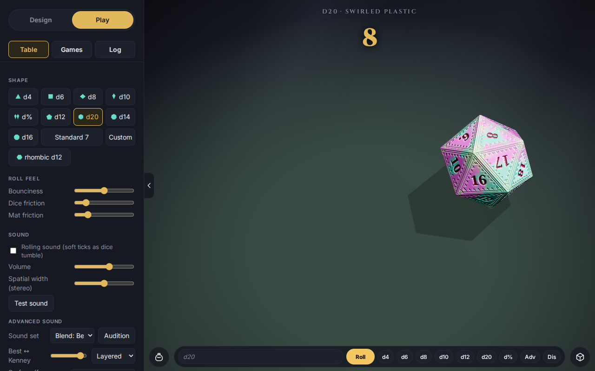
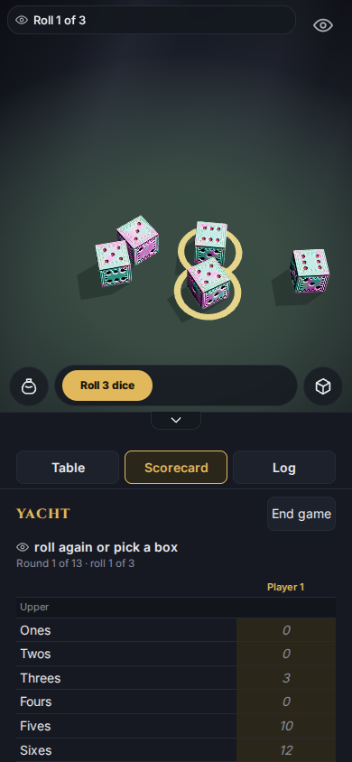
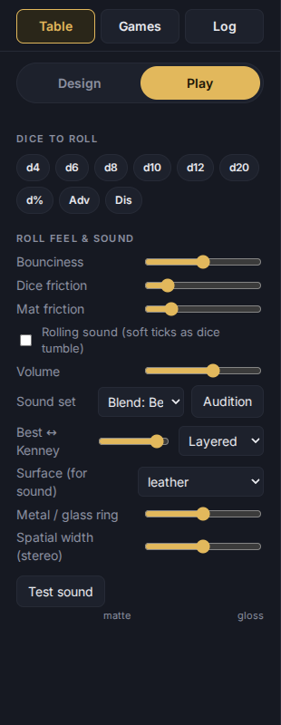

# Rolling

Switch to the **Play** room. The dice lie on the table; press the gold **Roll** button in the dock at the bottom (or `r`). They tumble and settle, and the total appears at the top of the table with the formula under it.

The **Roll** button is the only control that throws dice. Switching rooms, tapping a chip or opening a set never throws.

## Ways to roll again

- Press **Roll**, press `r`, or press Enter in the formula box.
- **Flick** the dice on the table: they are thrown the way you flicked, at the speed you let go.
- On a phone, **shake** the phone if the Shake option (Table tab) is on; it only appears on devices that can sense motion.

## The dock

Type a roll in the dock's formula box (for example `3d6+2` or `4d6kh3`) and press **Roll**. Empty, it rolls the dice you have loaded, and it shows what those are. A row of preset chips, **d4, d6, d8, d10, d12, d20, d%**, **Adv** and **Dis**, loads dice into the box: tap d20 for a d20, tap again for 2d20. **Adv** and **Dis** work the same way: a tap replaces the box with `d20adv` / `d20dis` (2d20 keep the highest / lowest), a double-click or long press adds that to what is typed. Tapping a chip does not throw; press **Roll** when ready. The same chips are in the **Table** tab. The text stays in the box after a roll, so you can edit it and roll again; clear the box to roll the dice that are loaded. Typed `adv` and `dis` work in the box too (`d20 adv`). What you can type, including group rolls such as `4x d20+2`, is listed in [Sets and the editor](04-sets-and-editor.md). Saved sets also get chips; tap one to load it, and it replaces whatever you had typed, so **Roll** throws that set. The box and **Roll** stay where they are; only the row of chips scrolls (mouse wheel, or drag it on a phone). The box is never squeezed to a sliver. **Adv** and **Dis** need a d20: with none in the box they say so instead of adding one. The dice on the mat follow the formula: a chip tap lays its dice down straight away, and a typed formula puts its dice down when you click out of the box (pressing **Roll** just rolls them). A formula that does not parse leaves the mat as it is.

**Formula history.** The box remembers the last 20 formulas and set names you rolled (most recent first, no repeats, kept when you reload). With the cursor in the box, press **Up** to step back through them, **Down** to step forward; past the newest, Down gives back what you were typing. Empty or mistyped formulas are not remembered. To see the list instead, click the small arrow at the right end of the box (it appears once you have rolled something), or on a phone press and hold the box (if you have selected part of the text, the phone's own selection handles win). In the list, click or tap an entry, or use the arrow keys and Enter, to put it in the box (it does not roll until you press **Roll**); Escape or a click elsewhere closes it. You can also type a set's name (any capitals) and press Enter or **Roll**: that picks the set and throws it, and if a set is named like a valid formula (a set called `2d6`), the set wins. A formula that is not a set name rolls its own dice.

A group roll shows its results side by side with a breakdown per roll, and a natural 20 (or 1) gets a banner; in a group roll it counts them ("2 × Natural 20"). Dice dropped by keep, drop, `adv` or `dis` do not count, and get a grey ring on the table.

## Holding dice

Tap a settled die to **hold** it: a gold ring appears and it stays put when you roll again. Tap it again to let go. Games use this for Yacht-style turns. A held die that a re-roll bumps is lifted and turned back to its face. A pink ring marks a die that is leaning (cocked), and a small chip at the top right of the table says **⚠ Fix N leaning dice** (tap it to re-roll just those); a leaning die cannot be held until it settles flat. The chip for held dice reads **N held · release**.

## Change one die's design

Press and hold a settled die for about half a second (or right-click it) to open a menu of the bag's designs. Pick one and just that die takes the new skin; its number and place stay and nothing is thrown. It only offers designs of the same die type. For layouts that cannot carry a per-die design (a group roll such as `4x d20`, kept or dropped dice such as `4d6kh3`, d% dice) the menu says **This layout cannot mix designs**. It is a shortcut: the **Sets** tab does the same job.

## Roll feel

In the **Table** tab, under **Roll feel**, **Gravity**, **Bounciness**, **Dice friction** and **Mat friction** change how the dice move (on a phone, also the **Shake phone to roll** option). 

**Gravity** is a slider on a log scale from 1/64x to 2x, shown as a multiple of realistic gravity: 1x is real gravity (9.81 m/s²) for a 20 mm d20. The default, marked "(default)", is the app's slow-motion table feel, about 1/23 of realistic, so dice hang in the air longer than in real life. Drag right and the dice fall faster; left and they float. A throw or flick scales with the setting, so the dice still fly and tumble the same way at any gravity. **Reset** next to the label returns to the default.

The **Sound** settings are further down the same tab; see [Sound](09-sound.md).

## Looking at the result

Hold the total at the top of the table, or hold `t`, for a top-down look at the dice (on a phone, hold the eye button in the top-right corner, where a right thumb reaches it without covering the dice; a quick tap on it only shows **Hold to look from above**); the controls step aside while you hold. Press `h`, or use **Full view** in the Utilities drawer, to hide the panel; the arrow at the screen edge brings it back.
