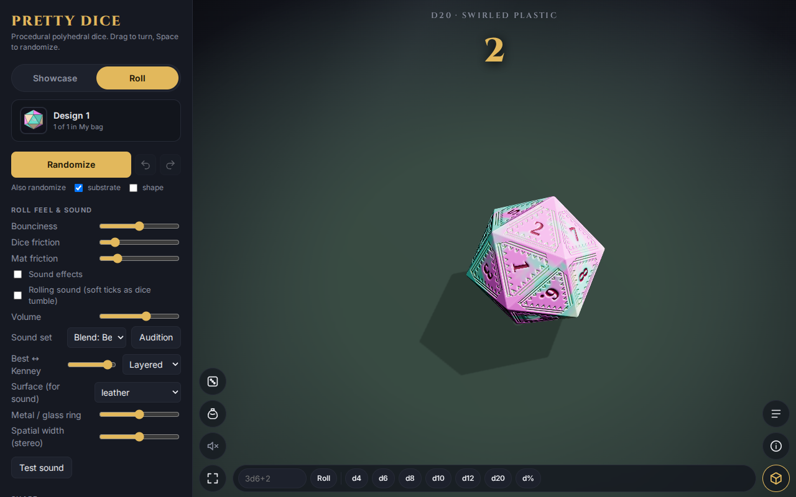
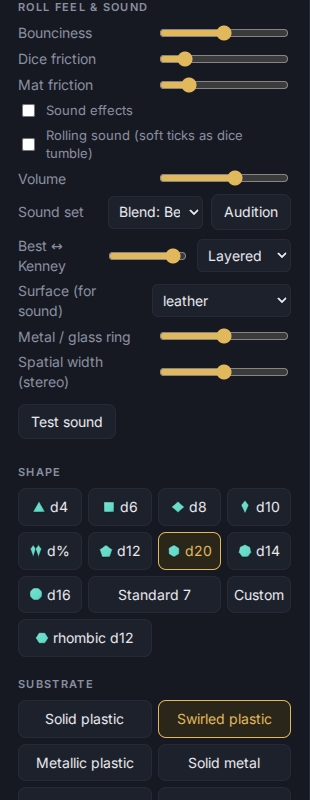

# Rolling

Switch to **Roll** (or tap the round Roll button). The dice are thrown, tumble and settle, and the total appears in large digits at the top of the table.

## Ways to roll again

- Press `r`.
- **Flick** the dice in the roll view.
- On a phone, **shake** the phone if the Shake option is on (it only appears on devices that can sense motion).
- Tap the Roll button once to leave the roll (it returns to the showcase), then again to throw a fresh roll.

## The quick roll bar

In Roll mode a bar at the bottom of the table lets you throw without opening the editor: type a roll (for example `3d6+2` or `4d6kh3`) and press **Roll**, or tap **d4, d6, d8, d10, d12, d20 or d%** to throw one of that die. What you can type is listed in [Sets and the editor](04-sets-and-editor.md).

## Holding dice

Tap a settled die to **hold** it: a gold ring appears and it stays put when you roll again. Tap it again to let go. Games use this for Yahtzee-style turns. A held die that a re-roll bumps is lifted and turned back to its face. A red-magenta ring marks a die that is leaning (cocked); a leaning die cannot be held until it settles flat.

## Roll feel

**Bounciness**, **Dice friction** and **Mat friction** change how the dice move. Sound settings are in the same section; see [Sound](09-sound.md).

## Looking at the result

Hold the total, or hold `t`, for a top-down look at the dice; the controls step aside while you hold. Press `h`, or long-press the layout button, for a distraction-free view with just one button left to bring the controls back.
