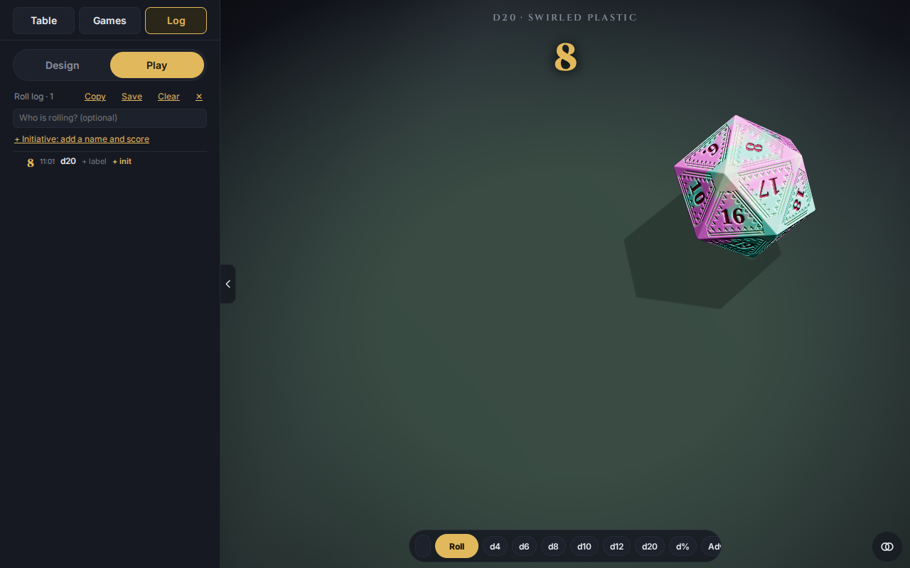
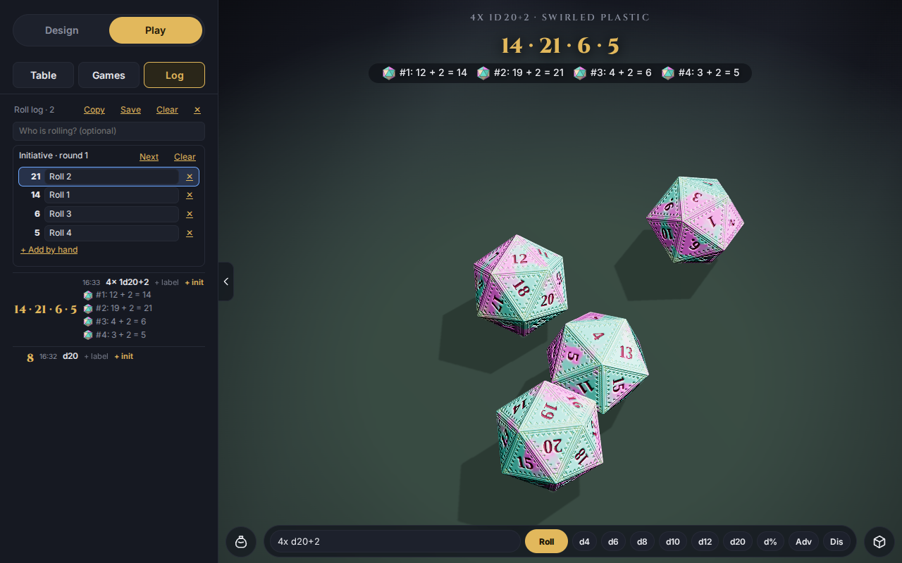

# The roll log

Every roll is recorded. Open the **Roll log** (the three-lines button) to see it. Entries can cover dice on the table: close the log with ✕ to see them.

Each entry shows the total, the time and what was rolled. A roll typed into the notation box or quick roll bar shows its formula (for example `d20` or `4x 1d20+2`); a roll of a saved set shows the set's name with ⚡. For rolls of several dice or a group roll, the entry lists each die or each roll.

## Name who is rolling

Type a name in **Who is rolling?** at the top and the entries that follow carry it. Useful when several people share a device.

## Label a roll

Tap **+ label** on an entry to add a note such as "Axe: damage".

## Track initiative

Tap **+ init** on any roll with a number total to add it to the **initiative list** at the top of the log. A group roll adds one row per roll.

- The list is sorted high to low. Rows get default names ("Roll 1", "Roll 2"…); click a name to rename it ("Goblin 1").
- **Next** moves the highlight to the next row. When it wraps past the last row the **round** counter goes up.
- ✕ removes a row; **Clear** (in the initiative box) empties the list.
- The list is saved with the bag and exported with it.

## Result tables

If the set you rolled has a result table ([Sets and the editor](04-sets-and-editor.md)), the matching line, such as **→ Goblins**, appears in the entry.

## Copy and Save as text

**Copy** puts the whole log on the clipboard as plain text and **Save** downloads it as a `.txt`. One line per roll, oldest first, with date and time, roller, label, total and the dice, plus any result-table line. Paste it into your session notes.

**Clear** (at the top of the log) empties the list.
