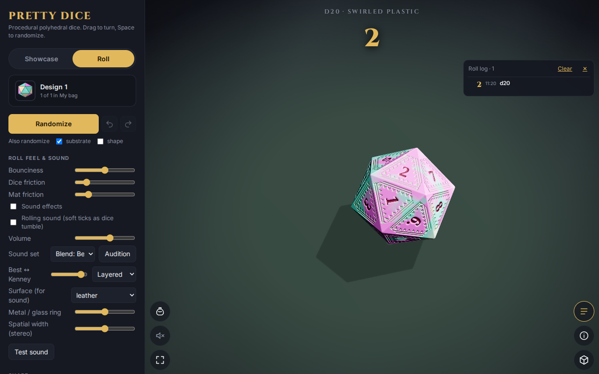

# The roll log

Every roll is recorded. Tap the **Roll log** button (the three lines, bottom right) to open it.

Each entry shows the total, the time and what was rolled (here a single d20). The header counts entries; **Clear** empties the list and ✕ closes it.
