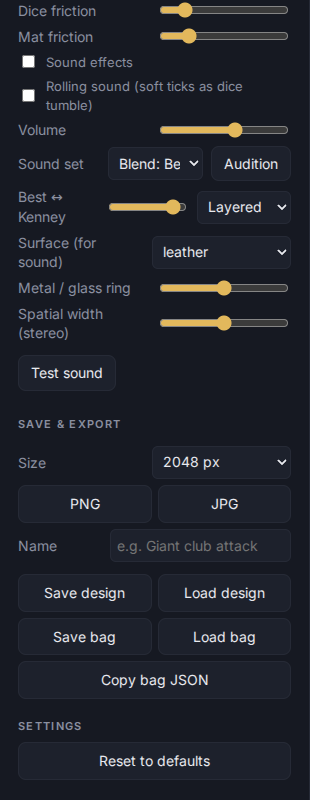

# Saving and loading

Your bag and settings are kept in the browser automatically. Use files when you want a backup, to move to another device, or to share.

Everything is in **Save & export** at the bottom of the settings panel.

| What | How |
|---|---|
| A picture of the current die | Pick a **Size** (current view, 1024, 2048 or 4096 px), then **PNG** or **JPG**. |
| One design | Give it a **Name**, then **Save design**. **Load design** reads one back. |
| The whole bag | **Save bag** writes a file; **Load bag** replaces this bag with a file. **Copy bag JSON** puts it on the clipboard. |
| Add a design without replacing the bag | Shelf **Add** > **From a file…** |

**Reset to defaults** (under Settings) puts the app back to how it started.
