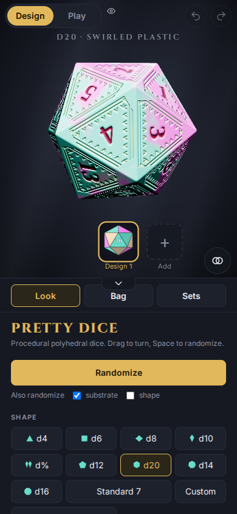
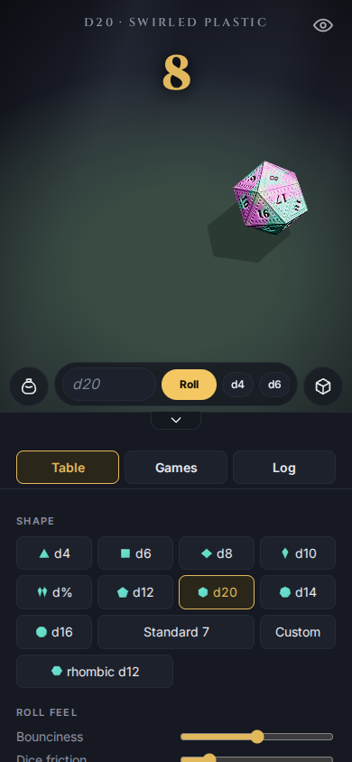

# Phone versus desktop

The same page adapts to the screen. Both sizes have the same two rooms, the same tabs and the same one **Roll** button.

|  | Desktop | Phone |
|---|---|---|
| Design \| Play switch | Just under the tabs in the side panel | Top left |
| Panel | Side panel on the left | A strip below the table that scrolls |
| Turn the die | Drag | Drag |
| Zoom, orbit | Scroll, right-drag | Pinch, two fingers |
| Roll again | `r`, Enter, **Roll**, flick | **Roll**, flick, shake (if offered) |
| Full view | Panel arrow, `h`, or Full view in the drawer | Arrow at the middle of the tab row, or Full view in the drawer |
| Bag | **Bag** tab, inline | **Bag** and **Sets** tabs open a full-screen sheet |

On a phone, hide the panel with its arrow when you want the whole table; the dock keeps the formula box and **Roll** on one row with the chips scrolling beside it. While a game is running the Games tab becomes **Scorecard**, and the game's status line is at the top of the table; hold it for a top-down look.

On small screens the long breakdown line wraps instead of running off the edge, and the leaning and held notices are small chips.

