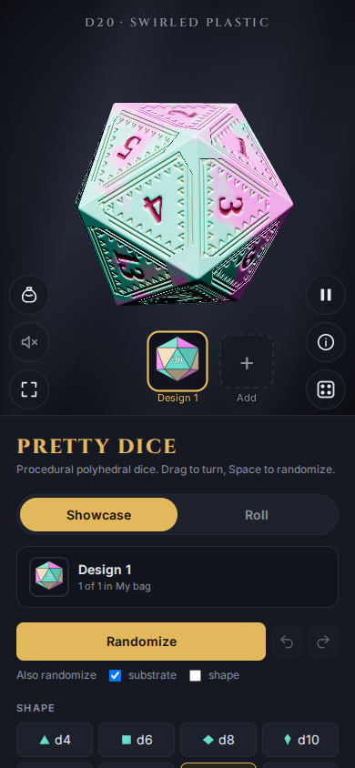
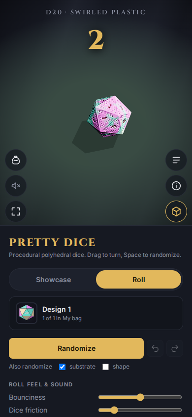
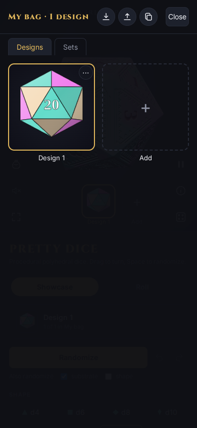

# Phone versus desktop

The same page adapts to the screen.

|  | Desktop | Phone |
|---|---|---|
| Settings | A side panel on the left | A panel below the table; scroll down to reach it |
| Turn the die | Drag | Drag |
| Zoom, orbit | Scroll, right-drag | Pinch, two fingers |
| Roll again | `r`, flick | Flick, shake (if offered) |
| Full view | Layout button, `h` | Layout button |

