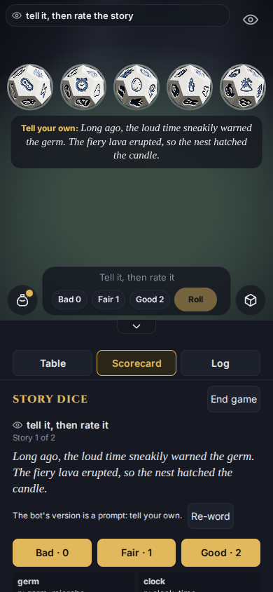
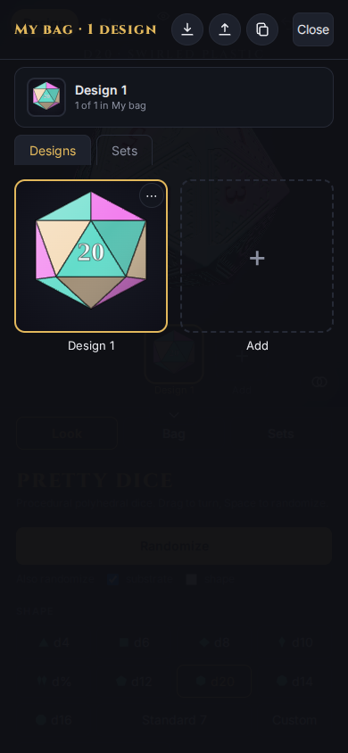
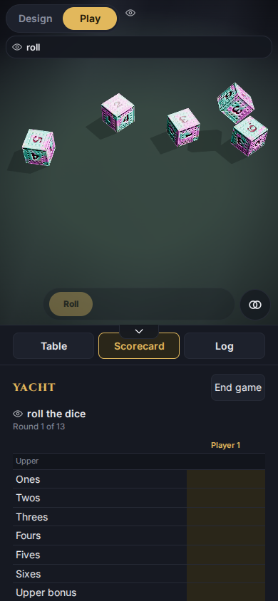
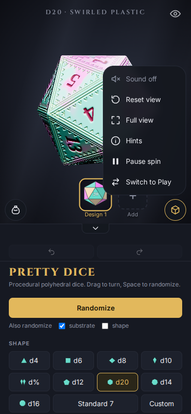

# Phone versus desktop

The same page adapts to the screen. Both sizes have the same two rooms, the same tabs and the same one **Roll** button. The Utilities drawer (sound, Reset view, Full view, Hints, Pause spin, and on a phone the room switch) is the button at the right edge of the table, bottom right.

|  | Desktop | Phone |
|---|---|---|
| Design \| Play switch | Top of the side panel | In the Utilities drawer (**Switch to Play** / **Switch to Design**) |
| Panel | Side panel on the left | A strip below the table that scrolls |
| Turn the die | Drag | Drag |
| Zoom, orbit | Scroll, right-drag | Pinch, two fingers |
| Roll again | `r`, Enter, **Roll**, flick | **Roll**, flick, shake (if offered) |
| Full view | Panel arrow, `h`, or Full view in the drawer | Arrow at the middle of the tab row, or Full view in the drawer |
| Bag | The round **Bag** button opens the Bag view (a centred sheet) | The round **Bag** button opens the Bag view (full screen) |
| Undo / Redo | Top strip of the panel (Design room), always in view | Top strip of the panel (Design room); it scrolls away with the panel, scroll back up to reach it |

On a phone, hide the panel with its arrow when you want the whole table; the dock keeps the formula box and **Roll** on one row with the chips scrolling beside it. While a game is running the Games tab becomes **Scorecard**, and the game's status line is at the top of the table; hold it for a top-down look.

## Games on a phone

**Scoring Yacht.** A mouse click on a scorecard box scores it at once; a finger does not. On a touch screen a tap only previews the box (the dock says what it would score) and you **long press** it, by default, to score. A **Score entry** menu under the card, shown only on touch devices, switches to **Double tap to score** or **Single tap scores**. After a score, **Whoopsie! Undo** shows for 3 seconds on either screen.

**Story Dice.** On a phone the dice rows are small: in landscape the dice and rings sit in one row, and with more than five dice in portrait they split into two rows. The story sentence appears on the mat and the **Bad / Fair / Good** buttons in the dock, so the side panel is not needed while you play. In a landscape split view, collapse the panel (the arrow at the middle of the tab row, or Full view in the drawer) for room; the dice spread out again when the screen changes size. The **Story Dice sets** editor is in the Games tab like the rest of the panel.

On small screens the long breakdown line wraps instead of running off the edge, and the leaning and held notices are small chips at the top right of the table (beside the top-down eye on a phone).

