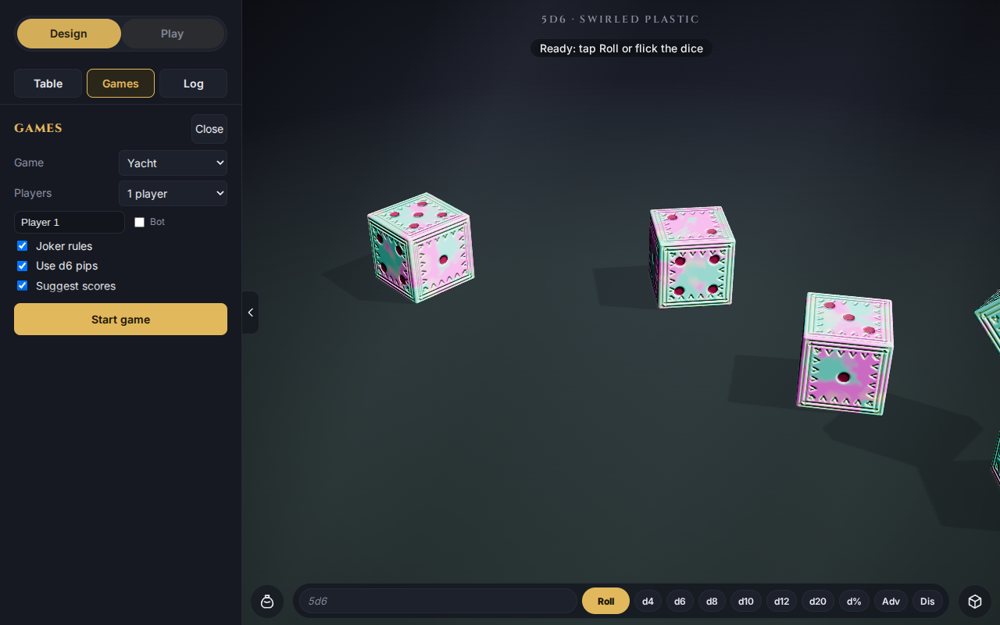
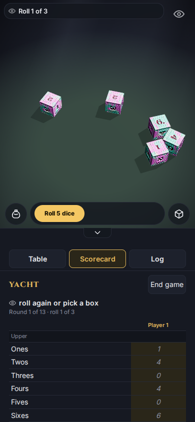

# Games

Pretty Dice can run a game for you with your own dice: it keeps score, suggests moves and tracks whose turn it is. Games work with the dice and design you have picked.

## Start a game

Switch to the Play room and open the **Games** tab. Choose a **Game** (the game puts its own dice on the table, for example two d6 for Craps, and your dice come back when it ends), the number of **Players**, and press **Start game**. Each player can be named, and a **Bot** box next to a name makes that seat play itself. **Suggest scores** (on by default) shows hints; turn it off for a plain scorecard.

| Game | Setup options |
|---|---|
| Yacht | 1 to 6 players, joker rules |
| Ten Thousand | target score, minimum to get on the board |
| Pig | target score |
| Craps | starting bankroll, minimum bet, max odds multiple |
| Liar's Dice | 2 to 6 players, dice each, ones are wild (bid 2-6 only) |

## Play Yacht (a walk-through)

1. Press the dock's **Roll** button (it reads **Roll** or, with dice held, **Roll 3 dice**). The dice are thrown and the scorecard fills with what each box would score: **italic** numbers are suggestions and the best one is **bold gold**.
2. **Tap a settled die to hold it**; a gold ring shows. The dock button now says how many will be thrown, for example **Roll 3 dice**.

3. Roll again (up to three throws), then tap a scorecard box to score it. After 13 rounds the game ends. **End game** quits early and returns you to the Games setup, still in the Play room. While a game runs, the Games tab becomes the **Scorecard** tab.

While a game runs the big total on the table is hidden: the status line at the top (with the eye icon) shows the turn, and holding it, or the eye button in the top-right corner on a phone, or holding the `t` key, gives a top-down look at the dice. The dock holds the game's actions (such as **Bank** or **Cash out**) beside the one gold Roll button; the preset chips are hidden until the game ends. You can visit the Design room mid-game; the game keeps going and Play shows a dot.

## The other games

A quick tour of each; every game has its own rules and options in the Games panel.

- **Ten Thousand and Pig:** roll, then set aside scoring dice (Ten Thousand) or **Bank**. A bust shakes and reddens the status line; hot dice glow gold.
- **Craps:** play money. Set a bet amount and tap a bet to add a unit; tap or hold a chip stack to take it down. Bets are grouped (line, come, numbers, one-roll). **Rules** explains each bet, and **Cash out** closes the table.
- **Liar's Dice:** each player's dice are hidden from the others. Odds and suggested bids are off by default, so a solo game against bots is not spoiled. To practise with them, turn on **Show odds and suggested bids (practice)** in the game's setup options. Holding down your own cup to peek at your dice is always available. With two or more people on one device, a **Pass the device** screen appears between turns. Bot seats play on their own.

## Resume a game

A game in progress is saved on your device. Reload the page, open the Games tab, and a **Resume** button restores it exactly.
