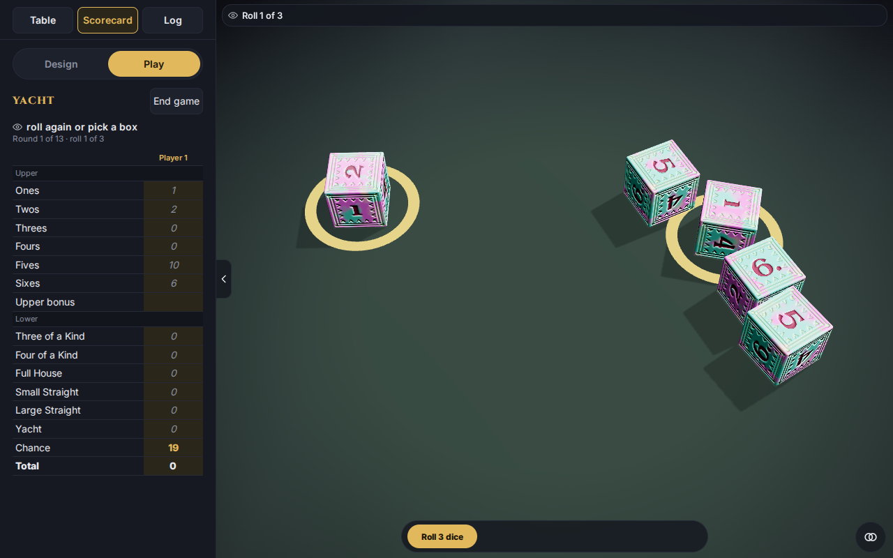
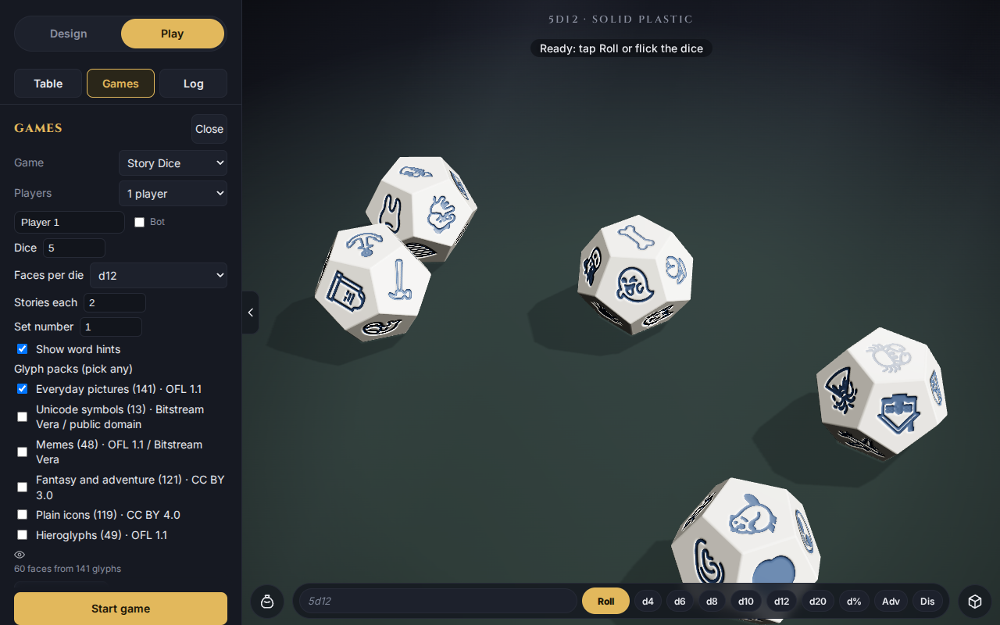
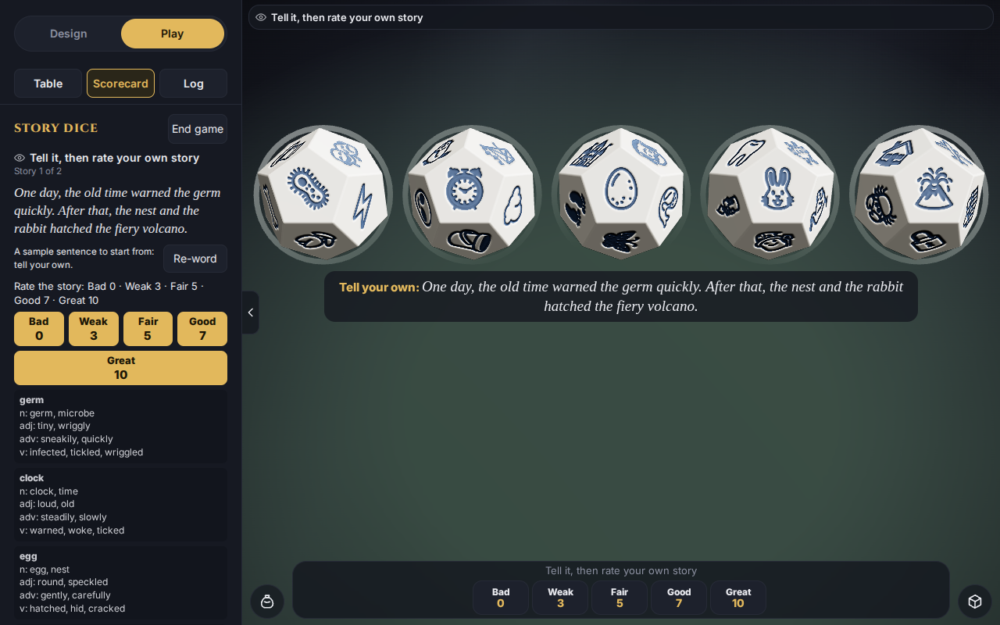
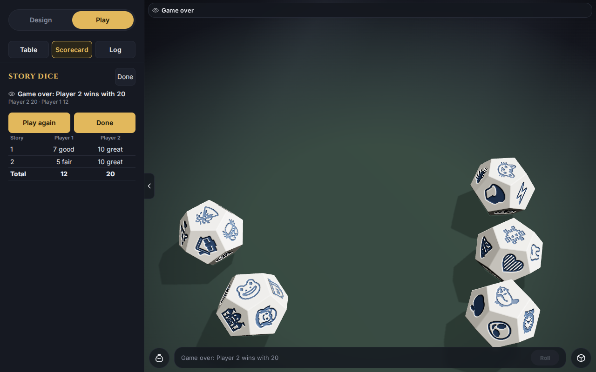
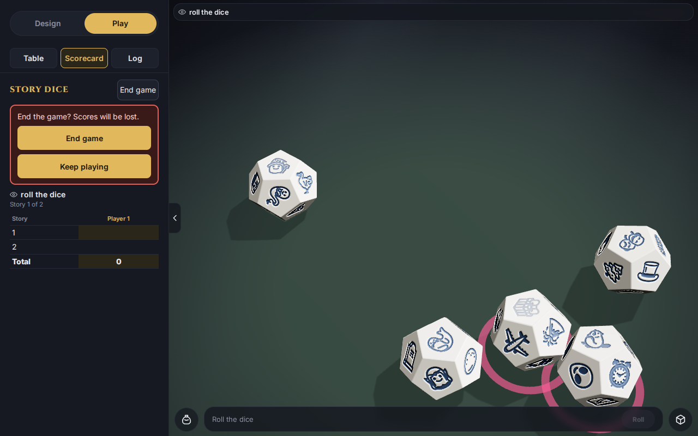
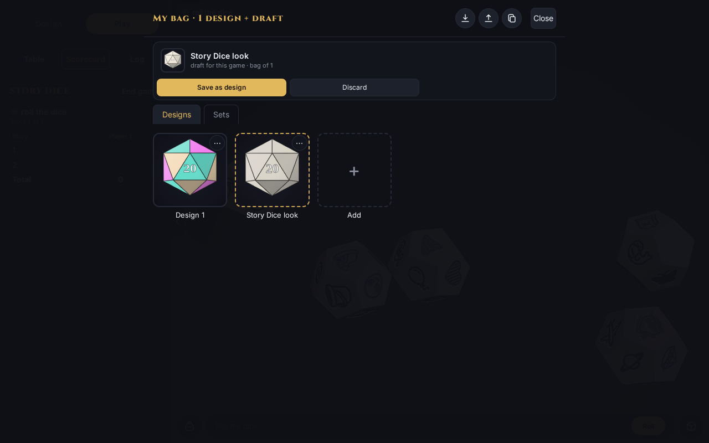

# Games

Pretty Dice can run a game for you with your own dice: it keeps score, suggests moves and tracks whose turn it is. Games work with the dice and design you have picked.

## Start a game

Switch to the Play room and open the **Games** tab. Choose a **Game** (the game puts its own dice on the table, for example two d6 for Craps, and your dice come back when it ends), the number of **Players**, and press **Start game** (it stays in view at the bottom of the panel, so you never have to scroll for it). Each player can be named, and a **Bot** box next to a name makes that seat play itself. **Suggest scores** (on by default) shows hints; turn it off for a plain scorecard.

| Game | Setup options |
|---|---|
| Yacht | 1 to 6 players, joker rules |
| Ten Thousand | target score, minimum to get on the board |
| Pig | target score |
| Craps | starting bankroll, minimum bet, max odds multiple |
| Liar's Dice | 2 to 6 players, dice each, ones are wild (bid 2-6 only) |
| Story Dice | 1 to 6 players, 3 to 9 dice, faces per die, stories each, set number, word hints, glyph packs |

## Play Yacht (a walk-through)

1. Press the dock's **Roll** button (it reads **Roll** or, with dice held, **Roll 3 dice**). The dice are thrown and the scorecard fills with what each box would score: **italic** numbers are suggestions and the best one is **bold gold**.
2. **Tap a settled die to hold it**; a gold ring shows. The dock button now says how many will be thrown, for example **Roll 3 dice**.

3. Roll again (up to three throws), then score a box (see below). After 13 rounds the game ends. **End game** quits early and returns you to the Games setup, still in the Play room (Story Dice asks first: **End the game? Scores will be lost.** with **End game** and **Keep playing** buttons). While a game runs, the Games tab becomes the **Scorecard** tab.

### Scoring a box, and Whoopsie

Scoring is deliberate so a stray touch does not cost you a box. **On desktop, a single click on a box scores it.** On a **touch screen a single tap only previews**: the box is highlighted and the dock says what it would score (for example "Hold Full house (25) to score it"). To score, **long press** the box (the default) or **double tap** it. A **Score entry** menu under the card, which only appears on touch devices, lets you choose **Double tap to score**, **Long press to score** (the default) or **Single tap scores**.

Right after any score a **Whoopsie! Undo** button appears beside the Roll button with a 3-second countdown. Press it and the score is taken back: your dice, throws and turn return as they were. After 3 seconds the score is locked in. Computer players wait for the window to close before they move.

### Around the table

While a game runs the big total on the table is hidden: the status line at the top (with the eye icon) shows the turn, and holding it, or the eye button in the top-right corner on a phone, or holding the `t` key, gives a top-down look at the dice. The dock holds the game's actions (such as **Bank** or **Cash out**) beside the one gold Roll button; the preset chips are hidden until the game ends. A tap on the eye button on a phone only shows the hint **Hold to look from above**; hold it to look. You can visit the Design room mid-game; the game keeps going and Play shows a dot.

**Changing a die's design in a game:** you can pick another design from the Bag, a set with the same dice, or press Randomize while a game runs. Applying a set mid-game never rolls and adds nothing to the Roll log. Only the look changes; the dice, their values and your holds stay as they are. A design or set with different dice (another shape or a different count) is refused with a message.

## The other games

A quick tour of each; every game has its own rules and options in the Games panel.

- **Ten Thousand and Pig:** roll, then set aside scoring dice (Ten Thousand) or **Bank**. A bust shakes and reddens the status line; hot dice glow gold.
- **Craps:** play money. Set a bet amount and tap a bet to add a unit; tap or hold a chip stack to take it down. Bets are grouped (line, come, numbers, one-roll). **Rules** explains each bet, and **Cash out** closes the table. When a computer player is the shooter and a person is at the table, the bot places its bets and then waits: place or change your own bets, then press **Ready** and the bot rolls.
- **Liar's Dice:** each player's dice are hidden from the others. Odds and suggested bids are off by default, so a solo game against bots is not spoiled. To practise with them, turn on **Show odds and suggested bids (practice)** in the game's setup options. Holding down your own cup to peek at your dice is always available. With two or more people on one device, a **Pass the device** screen appears between turns. Bot seats play on their own.

## Story Dice

Story Dice is a party game for 1 to 6 people (a seat can be a **Bot**). The dice carry small pictures instead of numbers. Each turn you roll them, put them in an order that makes a story, tell the story out loud, and the table rates it.

**Setup.** Choose **Story Dice** in the Games panel. The options are **Dice** (3 to 9), **Faces per die** (d6, d8, d12 or d20), **Stories each**, **Set number**, **Show word hints**, and the **Glyph packs** the pictures are dealt from. Pick another **Set number** for a different deal; the same options always deal the same dice, on any device. Every face on every die is a different picture, so Start stays off and says so if the packs hold too few (5 d12 need 60). The dice appear on the mat as soon as you pick the game; see [Look and designs](#look-and-your-designs) below for what happens to your own dice.

**Play.**

1. **Roll.** The dice tumble, settle, then fly up into two rows facing you: the pool at the bottom and numbered rings (1, 2, 3 ...) above.
2. **Arrange.** Tap the dice in story order to fill the rings, or drag them onto a ring. A picked-up die grows a little. Tap a placed die to send it back to the pool. **Autoswap when dropping on a filled ring** swaps two dice instead of refusing; **Hi-vis** swaps the 3D dice for flat picture tiles.
3. **The sentence.** When every ring is filled, the story sentence appears on the mat where the unplaced dice were, and wraps onto more lines if it is long. On your own turn it is a prompt: tell your own story, and **Re-word** gives another sample (Re-word is only there on your own turn; a bot's sentence is what it said). With **Show word hints** on, the panel lists nouns, adjectives, adverbs and verbs for each picture.
4. **Rate.** The dock shows five buttons: **Bad 0**, **Weak 3**, **Fair 5**, **Good 7** and **Great 10**, with the status hint above them. The same five buttons are in the panel, under a one-line scale reminder ("Rate the story: Bad 0 · Weak 3 · Fair 5 · Good 7 · Great 10"). Press one. One rating per story, and it is the **other people** at the table who judge: when another person is seated, the status line and the dock hint read "Player 1: tell it. Everyone else judges". Bots never rate. Playing solo, or with only bots as the other seats, the hint reads "Tell it, then rate your own story" and you rate your own story. After everyone has told their stories each, the highest total wins.

The dice stay movable while you arrange, and even after the rings are full, until you press a rating; then they are **locked** until the next roll. A bot seat rolls, arranges its dice and tells a silly ad-lib story, borrowing words from its own dice; the status line says "Bot told a story: rate it". Its story **always waits for a human rating**, even if every player is a bot, so nothing rates or advances by itself. Because the pictures and sentence sit on the mat and the buttons are in the dock, you can play with the side panel closed (Full view). The Roll log keeps each roll's story.

**When the game ends** the panel shows a game over screen: the winner and their total ("Game over: Ann wins with 24"; tied players are joined with "&"), or "Game over: your total: 17" when you played alone, then everyone's scores, and two buttons. **Play again** starts a new game with the same players and options (and a fresh set number, so a new deal); **Done** goes back to the Games setup. The dock goes back to its normal one-row height once the game is over (it is a little taller only while you rate).

### Look and your designs

Story Dice uses a temporary **game look**: plain white dice with the pictures on them, so the glyphs read clearly. It never overwrites your designs. While the game look is on screen:

- The Bag shows your own design's picture, plus a dashed **Story Dice look (draft)** tile for the temporary one (the name is cut short in the tile).

- Your design, any unsaved edits, your sets and Undo are untouched.
- If you deliberately pick a design from the Bag, or press Randomize, mid-game, that choice is kept as your look afterwards. (Only the look changes; a running game keeps its dice.)

The game look stays on the table for as long as you are on the **Games** tab: after a game ends, or with a paused game and **Resume** after a reload. It is released, and your own dice and design come back exactly, when you pick another game or leave the Games tab (Table, Log, Design, or hide the panel). A game that is running keeps its dice wherever you go.

If you press **Roll** in the dock while Story Dice is only selected and not started, the preview is released and your own dice roll: the formula you typed (say `2d6`), or your current dice if the box is empty. The selection stays, and opening the Games tab shows the preview again.

On a phone see [Phone versus desktop](08-phone-vs-desktop.md).

### Story Dice sets

Under Games > Story Dice, **Story Dice sets...** opens a list of your Story sets. A Story set is an ordinary saved set, so each one also appears in the Bag's **Sets** tab and as a chip at the table.

- **New Story set** starts a draft. Pick the **Glyph packs**, the number of **Dice** (3 to 9), **Faces per die**, a **Seed** (**Reroll seed** picks one at random), **Faces on the dice** (different on every die, or the same on every die) and **Glyph order** (shuffled by seed, or in pack order). A live preview shows each die's faces and a sample sentence, and **Set text** shows the formula the set is saved as, with a **Copy** button (see [Sets and the editor](04-sets-and-editor.md#picture-faces)).
- **Save** puts it in the bag. Close, with a confirmation if you changed anything, throws the draft away.
- Each list row has ✎ to edit and **...** for **Edit**, **Roll it** (puts the set on the table), **Use in game**, **Make a copy** and **Delete**. **Use in game** loads the packs, dice, faces and seed into the Story Dice setup; the game only deals shuffled sets with different dice on each die, so other sets can be rolled but not used in a game.

## Resume a game

A game in progress is saved on your device. Reload the page, open the Games tab, and a **Resume** button (it reads, for example, **Resume Story Dice**) restores it exactly.
