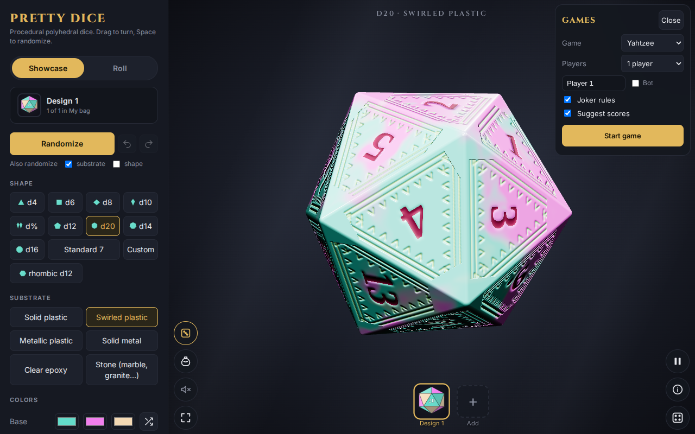
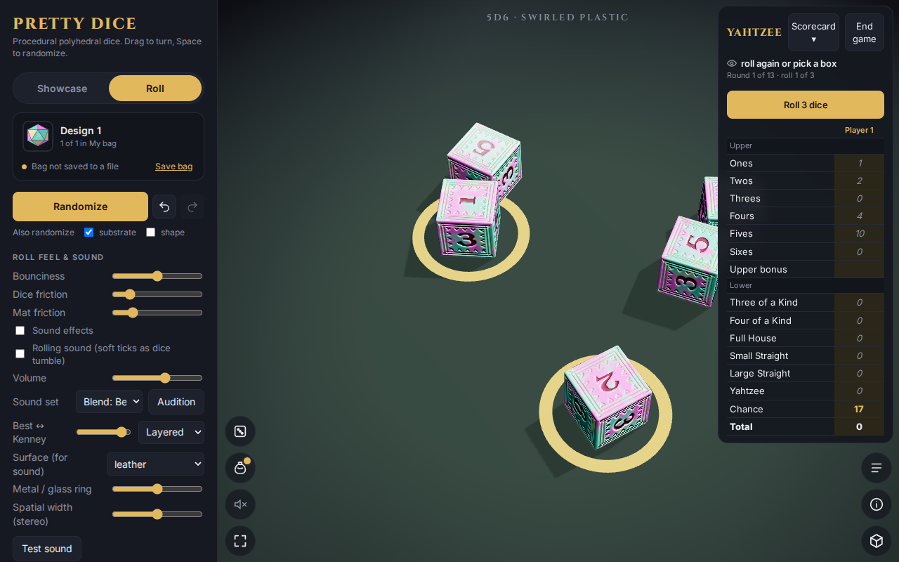

# Games

Pretty Dice can run a game for you with your own dice: it keeps score, suggests moves and tracks whose turn it is. Games work with the dice and design you have picked.

## Start a game

Tap the dice-face **Games** button (above the bag button). Choose a **Game**, the number of **Players**, and press **Start game**. Each player can be named, and a **Bot** box next to a name makes that seat play itself. **Suggest scores** (on by default) shows hints; turn it off for a plain scorecard.

| Game | Setup options |
|---|---|
| Yahtzee | 1 to 6 players, joker rules |
| Farkle | target score, minimum to get on the board |
| Pig | target score |
| Craps | starting bankroll, minimum bet, max odds multiple |
| Shut the Box | number of tiles, one-die rule once the high tiles are shut, rounds |
| Ship, Captain and Crew | rounds |
| Bunco | rounds |
| Liar's Dice | 2 to 6 players, dice each, ones are wild (bid 2-6 only) |

## Play Yahtzee (a walk-through)

1. Press **Roll**. The dice are thrown and the scorecard fills with what each box would score: **italic** numbers are suggestions and the best one is **bold gold**.
2. **Tap a settled die to hold it**; a gold ring shows. The button now says how many will be thrown, for example **Roll 3 dice**.

3. Roll again (up to three throws), then tap a scorecard box to score it. After 13 rounds the game ends. **End game** quits early and **Scorecard** folds the card away.

While a game runs the big total on the table is hidden: the status line (with the eye icon) shows the turn, and holding it, or holding the `t` key, gives a top-down look at the dice.

## The other games

A quick tour of each; every game has its own rules and options in the Games panel.

- **Farkle and Pig:** roll, then set aside scoring dice (Farkle) or **Bank**. A bust shakes and reddens the status line; hot dice glow gold.
- **Craps:** play money. Set a bet amount and tap a bet to add a unit; tap or hold a chip stack to take it down. Bets are grouped (line, come, numbers, one-roll). **Rules** explains each bet, and **Cash out** closes the table.
- **Shut the Box:** roll, then tap tiles that add up to the roll, then **Close**.
- **Ship, Captain and Crew:** up to three rolls; locked 6, 5 and 4 get gold rings; **Bank** cargo early.
- **Bunco:** each round has a target number and rolls score automatically.
- **Liar's Dice:** each player's dice are hidden from the others. With two or more people on one device, a **Pass the device** screen appears between turns. Bot seats play on their own.

## Resume a game

A game in progress is saved on your device. Reload the page, open Games, and a **Resume** button restores it exactly.
